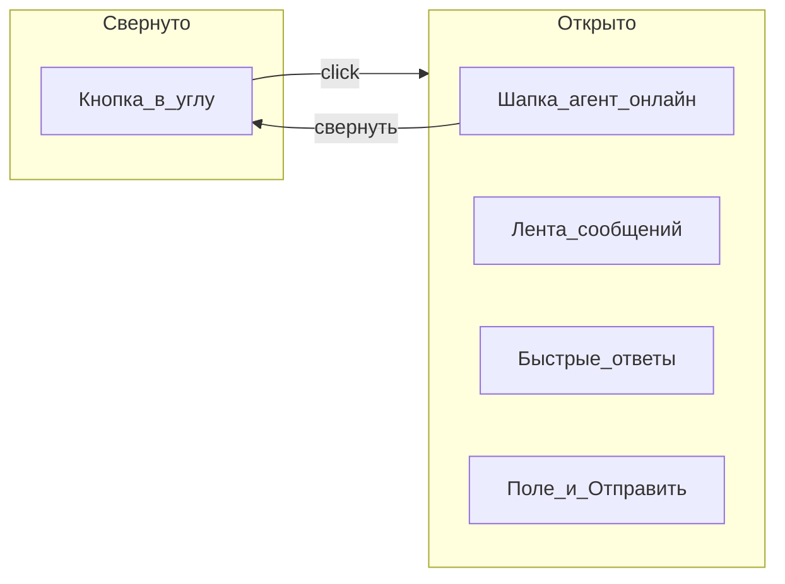

# Frontend чата ИИ-агента (виджет как Jivo)

## Контекст

Репозиторий `[D:\Students\wed 1500\11\ai-chat](D:\Students\wed 1500\11\ai-chat)` сейчас без приложения (только `[.cursor/rules/mock-data.mdc](.cursor/rules/mock-data.mdc)`). Стек: **Vite + React + JavaScript**, без бэкенда на первом этапе — ответы агента через моки и задержку «печатает…».

## Референс UX (Jivo)




| Элемент          | Поведение                                                                                      |
| ---------------- | ---------------------------------------------------------------------------------------------- |
| Плавающая кнопка | Правый нижний угол, иконка чата, бейдж непрочитанных (если панель закрыта и есть новые ответы) |
| Панель           | ~380×520px на десктопе, на мобиле почти на весь экран снизу; анимация scale/fade               |
| Шапка            | Аватар, имя агента, «В сети», кнопки темы и свернуть                                           |
| Сообщения        | Пузыри user справа / assistant слева, время, начальная история из моков                        |
| Индикатор        | «Агент печатает…» 0.8–1.5 с перед mock-ответом                                                 |
| Быстрые ответы   | 3–4 chip-кнопки под лентой (скрываются после первого сообщения пользователя или по клику)      |
| Ввод             | textarea + Enter (Shift+Enter — перенос), disabled пока «печатает»                             |


## Структура файлов

```
ai-chat/
  package.json
  vite.config.js
  index.html
  src/
    main.jsx
    App.jsx                    # демо «сайт» + монтирование виджета
    components/chat/
      ChatWidget.jsx           # состояние open/unread, оркестрация
      ChatLauncher.jsx
      ChatPanel.jsx
      ChatHeader.jsx
      MessageList.jsx
      MessageBubble.jsx
      ChatComposer.jsx
      TypingIndicator.jsx
      QuickReplies.jsx
    hooks/
      useChat.js               # messages, send, typing, mock reply
      useTheme.js              # light | dark, localStorage
    mocks/
      agent.mock.js            # id, name, avatar, status, welcome
      messages.mock.js         # стартовая переписка 4–6 сообщений
      replies.mock.js          # ответы по ключам + fallback
    styles/
      tokens.css               # CSS-переменные (цвета Jivo-like: акцент teal/green)
      themes.css               # [data-theme="light"|"dark"]
      chat-widget.css
    lib/
      formatTime.js
      getMockReply.js          # простой matcher + random fallback
```

Правило моков: все массивы сообщений и профиль агента — только в `[src/mocks/](src/mocks/)`, не в JSX.

## Логика чата (мок ИИ)

`[useChat.js](src/hooks/useChat.js)`:

1. Инициализация: `messages` из `messages.mock.js` + приветствие из `agent.mock.js`, если история пустая.
2. `sendMessage(text)`: append user-сообщение → `isTyping = true` → `setTimeout` → append assistant из `getMockReply(text)` → `isTyping = false`.
3. Если панель закрыта в момент ответа агента — увеличить `unreadCount`.
4. Заготовка под API: флаг `import.meta.env.VITE_USE_MOCKS !== 'false'` и отдельный модуль `src/api/chat.js` (пока stub), чтобы позже подменить мок без переписывания UI.

Пример формата сообщения (единый для UI и будущего API):

```javascript
{ id, role: 'user' | 'assistant', text, createdAt: ISO string, status?: 'sent' | 'read' }
```

## Тема свetлая / тёмная

`[useTheme.js](src/hooks/useTheme.js)`: `document.documentElement.dataset.theme`, ключ `ai-chat-theme` в `localStorage`, переключатель в шапке виджета (иконка sun/moon). Токены в `[tokens.css](src/styles/tokens.css)` + переопределения в `[themes.css](src/styles/themes.css)` — панель, фон ленты, пузыри, launcher.

## Демо-страница

`[App.jsx](src/App.jsx)`: простой лендинг (заголовок, пара блоков текста), чтобы виджет выглядел как на реальном сайте. Виджет рендерится через `<ChatWidget />` в корне (портал не обязателен — `position: fixed` на корневом контейнере виджета).

## Стили и доступность

- `prefers-reduced-motion` — укоротить/отключить анимации.
- Фокус на поле ввода при открытии панели; `aria-label` на launcher и кнопках; `role="log"` на ленте.
- Скролл к последнему сообщению при send/receive/open.

## Запуск и проверка

- `npm install` → `npm run dev`
- Чеклист: открыть/свернуть, отправить текст, быстрые ответы, бейдж при закрытой панели, переключение темы после перезагрузки, узкая ширина viewport (~375px).

## Что сознательно не входит в v1

- Реальный SSE/streaming к LLM, авторизация, файлы, звук, мультиязычность, embed-snippet для сторонних доменов (можно добавить отдельным шагом: сборка IIFE-бандла виджета).

## Зависимости (минимум)

- `react`, `react-dom`
- dev: `vite`, `@vitejs/plugin-react`

Без UI-библиотек — чистый CSS под контроль внешнего вида «как Jivo».